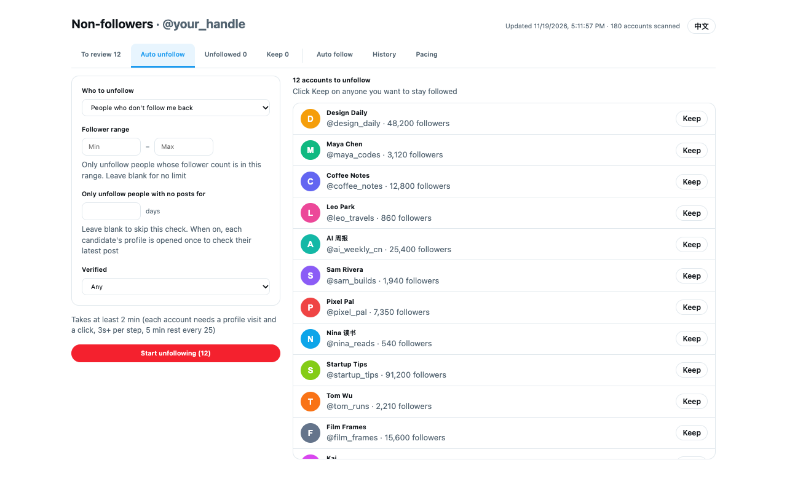
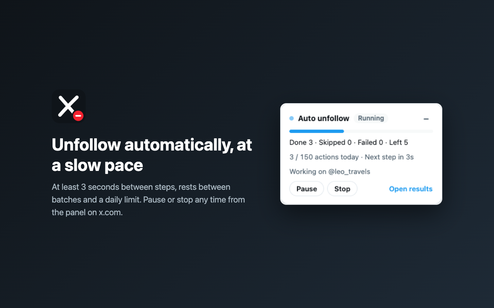
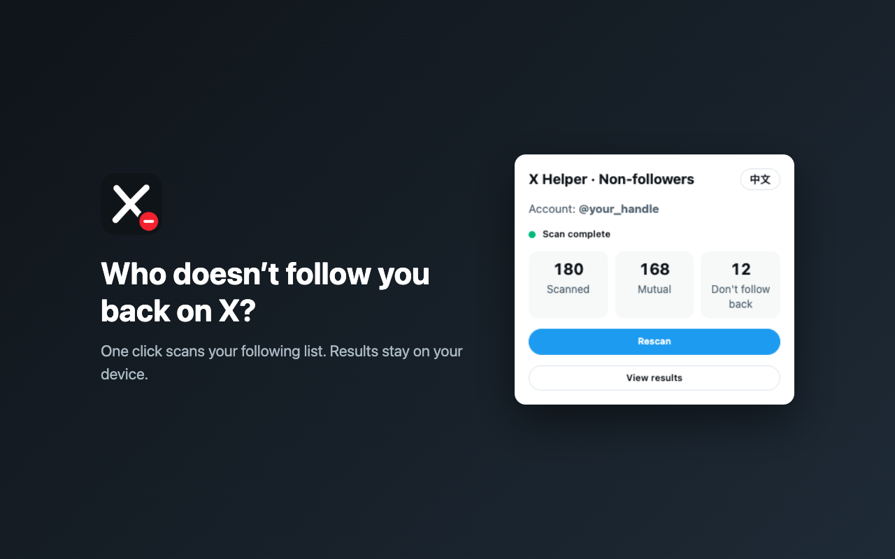
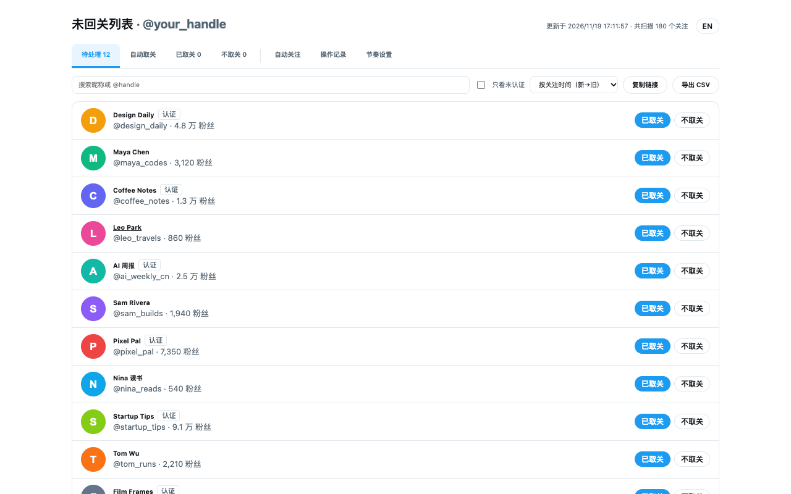
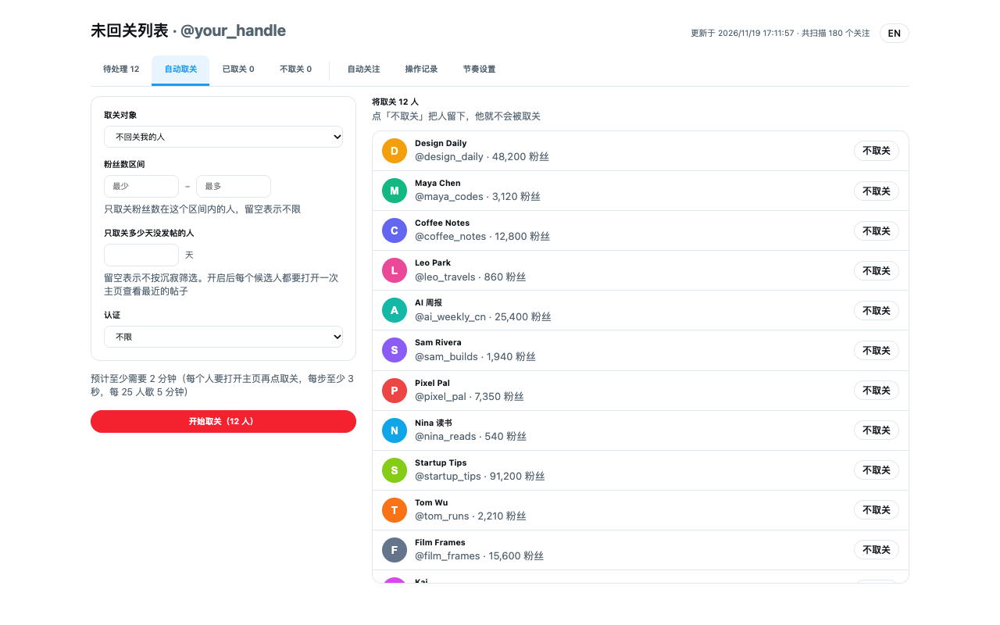
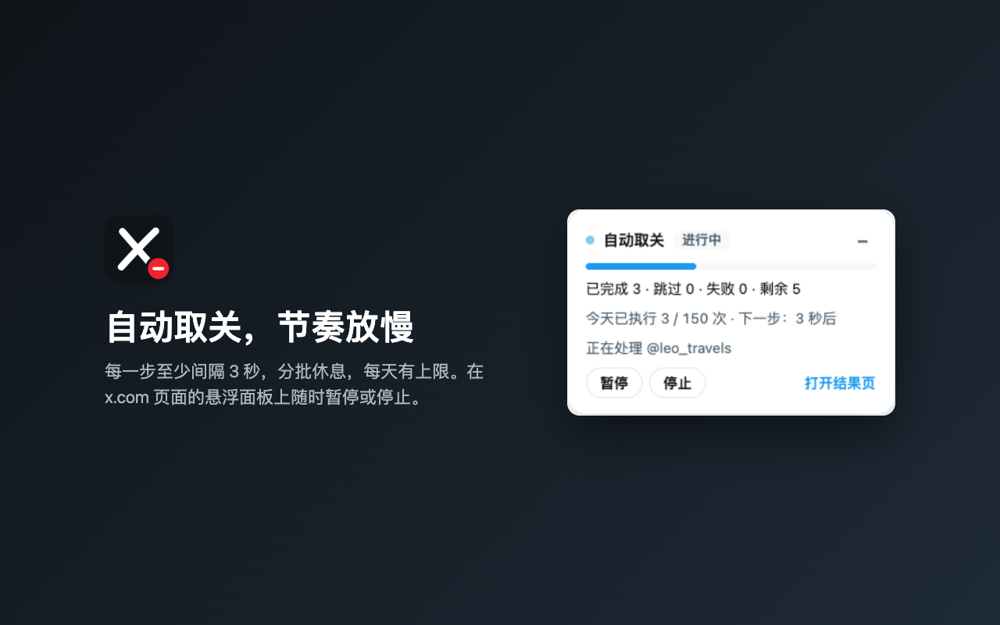
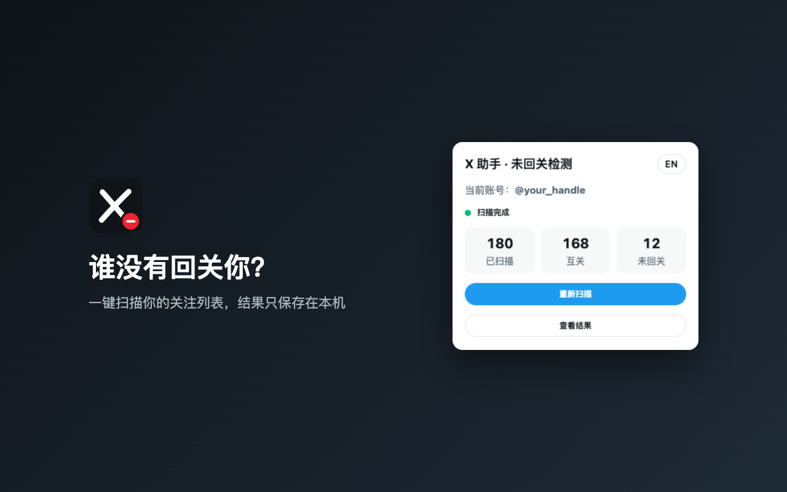

# X Helper

Chrome extension that shows which accounts you follow on X don't follow you back, and can unfollow them for you at a slow, steady pace.

**Download:** [latest release](https://github.com/certhon/x-helper/releases/latest) · **Privacy policy:** [PRIVACY.md](PRIVACY.md) · **Author:** [@certhon520 on X](https://x.com/certhon520)

Install: unzip the release file, open `chrome://extensions`, turn on Developer mode, click **Load unpacked**, and choose the unzipped folder.

下载：[最新版本](https://github.com/certhon/x-helper/releases/latest)。安装：解压后打开 `chrome://extensions`，开启「开发者模式」，点「加载已解压的扩展程序」，选择解压后的文件夹。作者：[X 上的 @certhon520](https://x.com/certhon520)

## Features

- Scan your following list and see who doesn't follow you back. Search, sort, show only unverified accounts, copy links, export CSV.
- Auto unfollow: filter by follow-back, follower count, days since last post and verified status. Review the list, click Keep on anyone you want to stay followed, then start.
- Auto follow: follow people from another account's followers or following list, with a follower range and a limit.
- Slow pacing: at least 3 seconds between steps, rests between batches, a daily limit. Pauses by itself when X rate-limits or asks for verification.
- A floating progress panel on x.com with Pause, Resume and Stop. History of every follow and unfollow, exportable as CSV.
- Your data stays in your browser. The only thing sent out is an anonymous usage count (random install ID, event name, version), see [PRIVACY.md](PRIVACY.md).

Aggressive bulk following or unfollowing is against X's rules and can get an account limited. The defaults are slow; use them responsibly.

## Screenshots

中文界面截图

Screenshots use made-up demo accounts. 截图中的账号均为虚构的演示数据。

X Helper is an independent extension and is not affiliated with X Corp.
