# X Helper

Chrome extension for X: analytics for your own posts, who replied to you, and replies you haven't answered yet. It also shows which accounts you follow don't follow you back, and can unfollow them for you at a slow, steady pace.

X Helper does not collect your X data. All of it stays on your own device. X 助手不收集你的 X 数据，所有 X 数据都只保存在你的本机。

**Download:** [latest release](https://github.com/certhon/x-helper/releases/latest) · **Privacy policy:** [PRIVACY.md](PRIVACY.md) · **Author:** [@certhon520 on X](https://x.com/certhon520)

Install: unzip the release file, open `chrome://extensions`, turn on Developer mode, click **Load unpacked**, and choose the unzipped folder.

下载：[最新版本](https://github.com/certhon/x-helper/releases/latest)。安装：解压后打开 `chrome://extensions`，开启「开发者模式」，点「加载已解压的扩展程序」，选择解压后的文件夹。作者：[X 上的 @certhon520](https://x.com/certhon520)

## Features

- Post analytics: views, posts, engagement rate, replies received and follower change for the last 7, 30 or 90 days, compared with the previous period. Daily views chart, average views by format and posting hour, and your posts ranked with how many times the median each got.
- Who replied: everyone who replied to your posts, grouped by person and filtered by day (today, yesterday, last 7 or 30 days, or any date).
- To reply: replies you haven't answered. Reply opens it on x.com; Ignore hides it.
- Scan your following list and see who doesn't follow you back. Search, sort, show only unverified accounts, copy links, export CSV.
- Auto unfollow: filter by follow-back, follower count, days since last post and verified status. Review the list, click Keep on anyone you want to stay followed, then start.
- Auto follow: follow people from another account's followers or following list, with a follower range and a limit.
- Slow pacing: at least 3 seconds between steps, rests between batches, a daily limit. Pauses by itself when X rate-limits or asks for verification.
- A floating progress panel on x.com with Pause, Resume and Stop. History of every follow and unfollow, exportable as CSV.
- **Does not collect your X data.** Your posts, replies, following list, account details, marks and history stay on your device and are never uploaded. The only thing sent out is an anonymous usage count (random install ID, event name, version, language) with no X data in it. See [PRIVACY.md](PRIVACY.md).

Aggressive bulk following or unfollowing is against X's rules and can get an account limited. The defaults are slow; use them responsibly.

## User guide

### 1. Install and open

1. Download the zip from the [latest release](https://github.com/certhon/x-helper/releases/latest) and unzip it.
2. Open `chrome://extensions`, turn on **Developer mode**, click **Load unpacked**, and choose the unzipped folder.
3. Open [x.com](https://x.com) and log in. The extension reads your handle from the page.
4. Click the X Helper icon in the toolbar, then **Open X Helper**. Everything is on this page: the left menu has a **Content** group and a **Following** group.

The language button in the top right switches between English and 中文.

### 2. Sync your posts and replies

Analytics, Who replied and To reply all need a sync first. The sync box sits at the top of these three pages.

1. Choose a range: last 7, 30 or 90 days.
2. Click **Start sync**. An x.com tab opens your profile, then your replies, then a search for replies to you, and scrolls slowly (at least 3 seconds between pages). Keep the tab open while it runs.
3. The panel at the top right of x.com shows progress, with **Pause** and **Resume**. A 30-day sync usually takes a few minutes.
4. If X stops returning data (rate limit), the sync pauses and keeps what it already read. Wait 10 to 15 minutes, then click **Resume**.

Sync again whenever you want fresh numbers. Syncing on different days also lets the extension show your follower change.

### 3. Analytics

- Pick **Last 7 / 30 / 90 days** at the top.
- The cards show views, posts, engagement rate, replies received and followers. The percentage below each card compares with the period before it, shown only if that period was synced too.
- **Views by posting day**: each bar adds up the views of the posts you made that day, counted until now. X doesn't give daily impressions, so this is the closest view. Click a bar to list only that day's posts. **Data table** shows the numbers.
- **Average views by format / by posting hour**: compare text, photo, video and link posts, and the hours you post at.
- **Post performance**: sort by views, engagement, likes or replies. The badge on the right (for example `2.4×`) is the post's views divided by the median for the period. Click a post to open it on X. **Export CSV** saves the list.

### 4. Who replied

- Filter by day: **Today**, **Yesterday**, **Last 7 days**, **Last 30 days**, or pick any date. You can also click a bar in the chart.
- **Only replies to my posts** hides replies to your comments under other people's posts.
- Each row is one person with their reply count. Click the count to see what they wrote and which post they replied to.
- Use the relationship filter to find people you don't follow yet, people who follow you, or mutuals. **Export CSV** saves the list.

### 5. To reply

- Lists replies to you that you haven't answered, newest first.
- **Reply** opens that reply on x.com so you can answer it yourself. The extension never posts for you.
- **Ignore** hides a reply you don't want to answer. Turn on **Show ignored only** to bring one back.
- After your next sync, the replies you answered disappear from the list. A reply marked **May be answered** is older than your synced replies, so the extension can't tell.

### 6. Find who doesn't follow you back

1. Click the toolbar icon, then **Start scan**. The extension opens your following list on x.com and scrolls through it slowly.
2. Open X Helper and go to **To review**. Search, sort, tick **Unverified only**, copy profile links or export CSV.
3. Unfollow on their profile yourself, then click **Unfollowed** to move them out of the list. Click **Keep** for anyone you want to stay followed. Both are only marks inside the extension.

### 7. Auto unfollow and auto follow

- **Auto unfollow**: choose who (people who don't follow you back, or everyone you follow) and narrow it by follower count, days since their last post, or verified status. The list on the right updates as you change the filters. Click **Keep** on anyone to leave out, then **Start unfollowing**.
- **Auto follow**: enter an account and follow people from its followers or following list, with a follower range and a limit, then **Start auto follow**. People you already follow or unfollowed before are skipped.
- The floating panel on x.com shows progress, with **Pause**, **Resume** and **Stop**. Tasks pause by themselves if X rate-limits or asks for verification.
- **History** records every follow and unfollow with the reason. Export it, or follow someone again in one click.
- **Pacing** sets the gap between steps (at least 3 seconds), the batch size and rest, and the daily limit.

Bulk following or unfollowing too fast can get your account limited by X. The defaults are slow on purpose.

### 8. Your data

Everything X Helper reads or records stays in your browser (`chrome.storage.local`) and is never uploaded. Posts and replies are kept for up to 120 days. Removing the extension deletes all of it. See [PRIVACY.md](PRIVACY.md).

中文使用手册

### 1. 安装和打开

1. 从[最新版本](https://github.com/certhon/x-helper/releases/latest)下载 zip 并解压。
2. 打开 `chrome://extensions`，开启「开发者模式」，点「加载已解压的扩展程序」，选择解压后的文件夹。
3. 打开 [x.com](https://x.com) 并登录，插件会从页面上认出你的账号。
4. 点工具栏里的 X 助手图标，再点「打开 X 助手」。所有功能都在这个页面里，左侧分「内容」和「关注管理」两组。

右上角的按钮可以切换中文 / English。

### 2. 同步帖子和回复

「数据分析」「回复我的人」「待回复」都要先同步，同步栏在这三页的最上面。

1. 选同步范围：最近 7、30 或 90 天。
2. 点「开始同步」。插件会在一个 x.com 标签页里依次打开你的主页、回复页和「回复你的」搜索结果，慢慢往下滚，每翻一页至少隔 3 秒。同步时别关这个标签页。
3. x.com 右上角的悬浮面板会显示进度，可以暂停、继续。同步 30 天一般几分钟。
4. 如果 X 暂时不返回数据（限流），同步会自动停下，已读到的数据会保留。过 10~15 分钟再点「继续」。

想看最新数据就再同步一次。在不同的日子同步，还能看到粉丝变化。

### 3. 数据分析

- 顶部选「近 7 / 30 / 90 天」。
- 卡片显示浏览量、发帖、互动率、收到的回复、粉丝。卡片下面的百分比是和前一段时间比，前一段时间也同步过才会显示。
- 「每天发帖的浏览量」：每根柱子是那天发的帖子到现在的浏览量总和。X 不提供每天的曝光量，这是最接近的看法。点柱子只看那天的帖子，「数据表」可以看具体数字。
- 「不同形式 / 发帖时段的平均浏览」：比较纯文字、图片、视频、链接帖子，以及你几点发帖的效果。
- 「帖子表现」：可以按浏览、互动率、点赞、回复排序。右边的倍数（比如 `2.4×`）是这条帖子的浏览量除以这段时间的中位数。点帖子在 X 上打开，「导出 CSV」保存列表。

### 4. 回复我的人

- 按天筛选：今天、昨天、近 7 天、近 30 天，或者选任意一天；也可以直接点图表里的柱子。
- 「只看回复我主贴的」会去掉你在别人帖子下面的评论收到的回复。
- 每行是一个人和他回复的次数，点次数可以看他回复了什么、回复的是哪条帖子。
- 可以按关系筛选：我还没关注的、关注了我的、互关的。「导出 CSV」保存名单。

### 5. 待回复

- 列出别人回复了你、你还没回复的，最新的在前。
- 「去回复」在 x.com 上打开那条回复，由你自己回复，插件不会替你发任何内容。
- 不想回的点「忽略」；勾选「只看已忽略的」可以找回来。
- 下次同步后，你已经回复过的会自动从列表里消失。标着「可能已回复」的，是比已同步的你的回复更早的，插件没法确定。

### 6. 找出没回关你的人

1. 点工具栏图标，再点「开始扫描」。插件会打开你在 x.com 上的关注列表并慢慢往下滚。
2. 打开 X 助手，进「待处理」。可以搜索、排序、勾「只看未认证」、复制主页链接、导出 CSV。
3. 在对方主页上自己取关，再点「已取关」把他移出列表；想继续关注的点「不取关」。这两个都只是插件里的标记。

### 7. 自动取关和自动关注

- 「自动取关」：选择取关对象（没回关你的人，或你关注的所有人），可以按粉丝数、多少天没发帖、是否认证筛选。改条件时右边名单会实时更新，不想取关的点「不取关」，然后点「开始取关」。
- 「自动关注」：输入一个账号，从他的粉丝或他关注的人里关注，可以设粉丝数区间和本次上限，然后点「开始自动关注」。已经关注的、以前取关过的会跳过。
- x.com 上的悬浮面板显示进度，可以暂停、继续、停止。X 提示限流或要求验证时，任务会自动暂停。
- 「操作记录」记下每次关注和取关的原因，可以导出，误取关的可以一键重新关注。
- 「节奏设置」可以改每步间隔（不低于 3 秒）、每批数量和休息时间、每天上限。

关注或取关太快可能导致账号被 X 限制，默认节奏是故意设慢的。

### 8. 你的数据

X 助手读到和记录的所有内容都只保存在你的浏览器里（`chrome.storage.local`），不会上传。帖子和回复最多保留 120 天。删除插件会删掉全部数据。详见 [PRIVACY.md](PRIVACY.md)。

## Screenshots

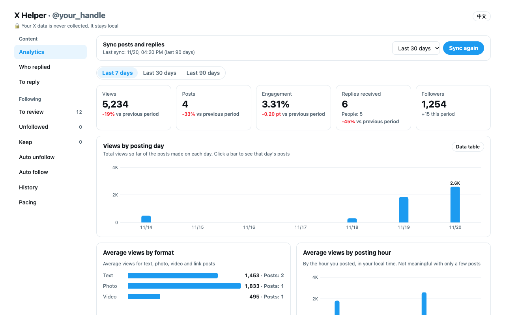
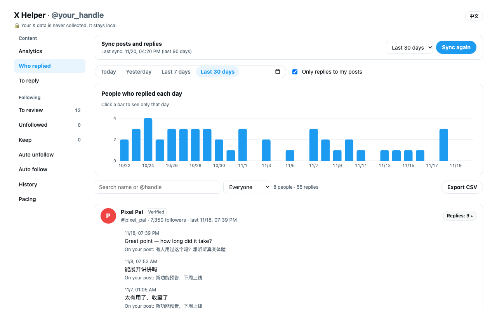
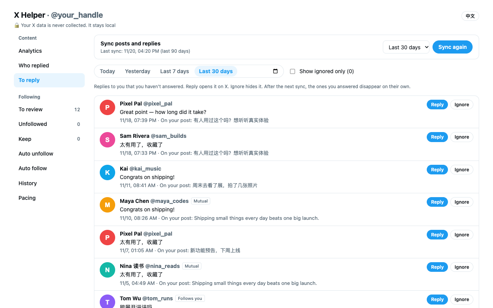
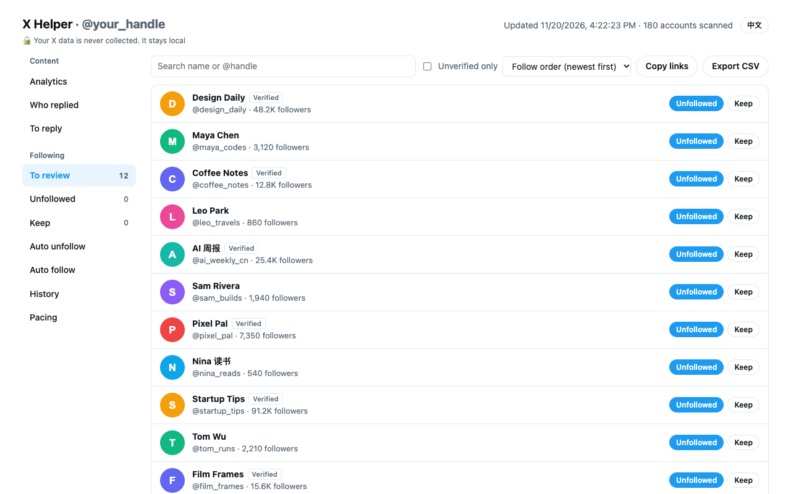
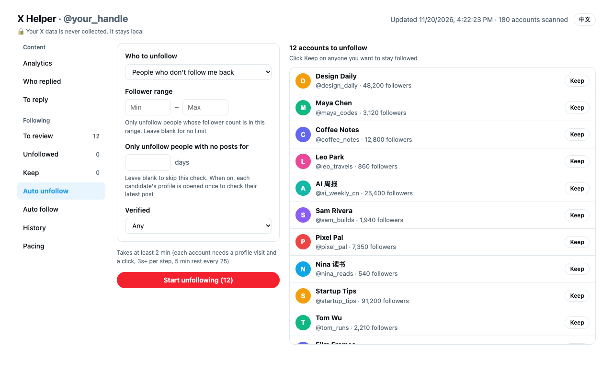
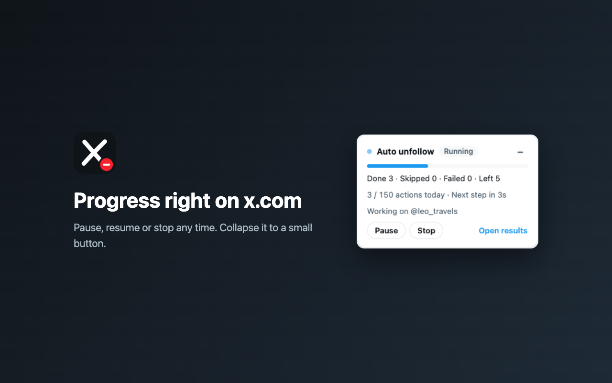
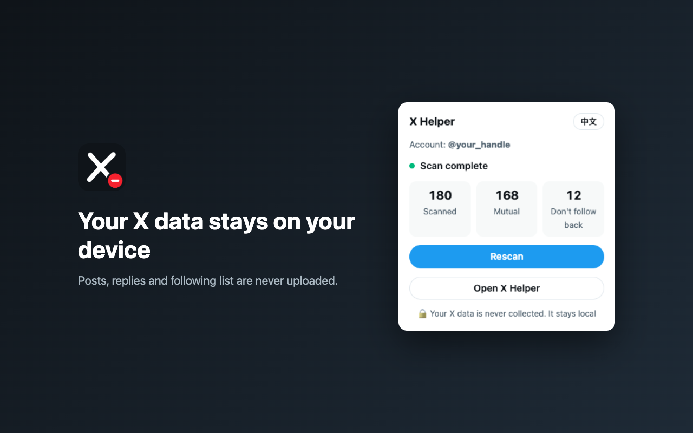

中文界面截图

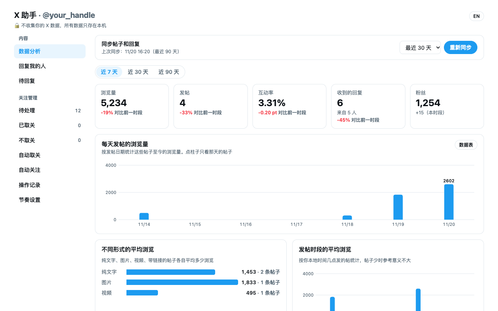
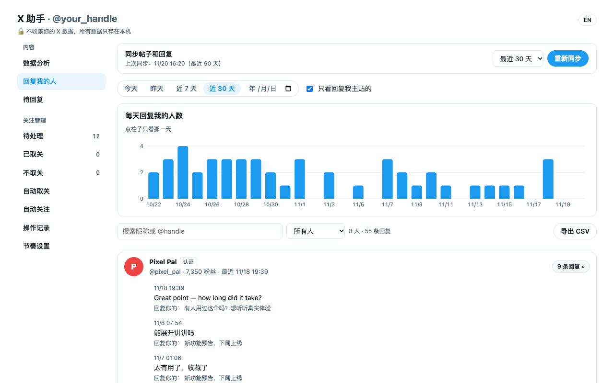
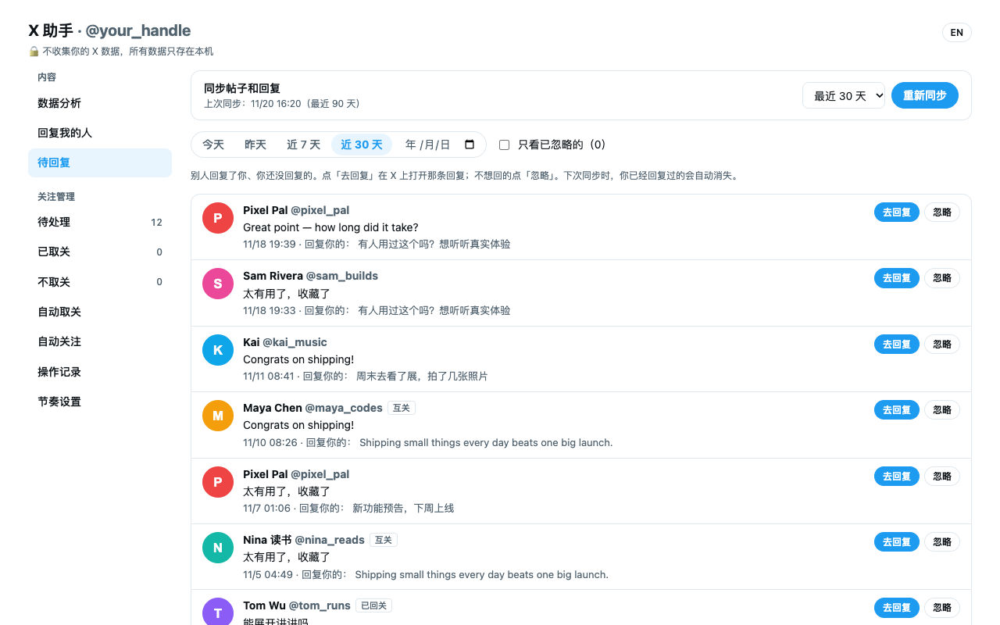
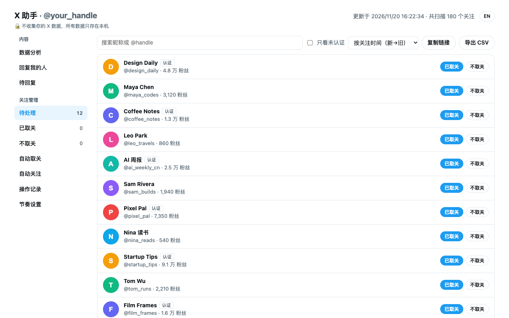
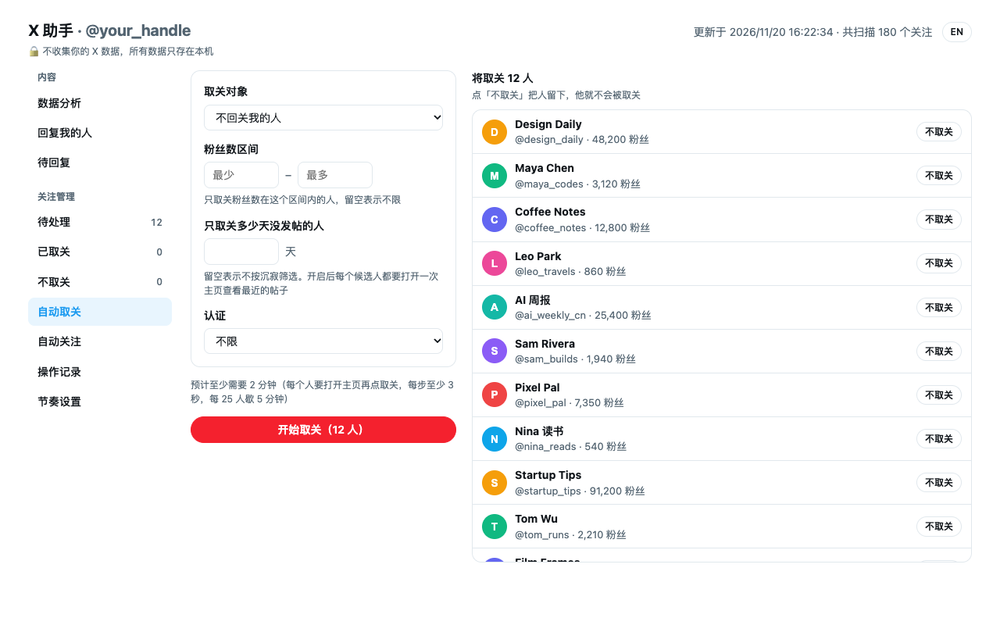
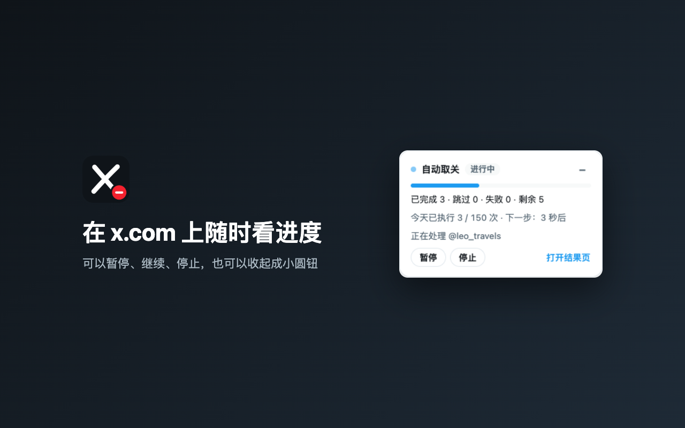
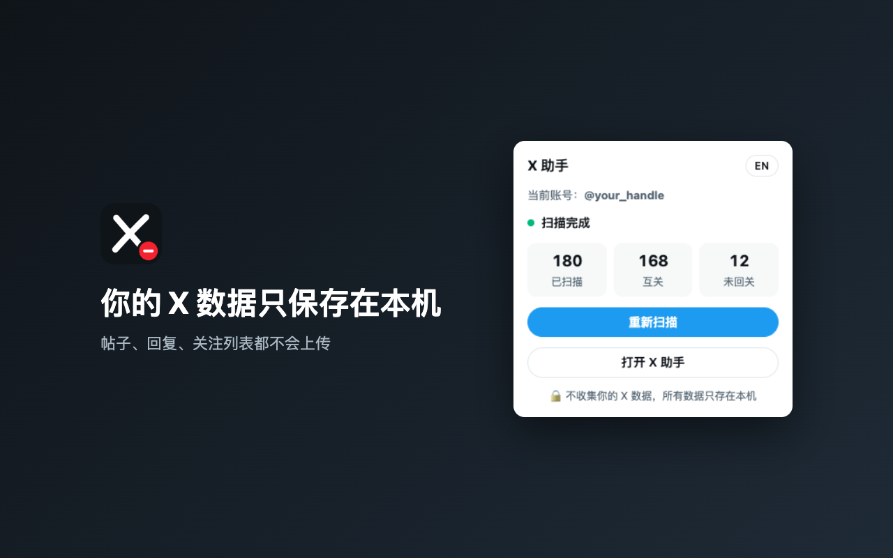

Screenshots use made-up demo accounts. 截图中的账号均为虚构的演示数据。

X Helper is an independent extension and is not affiliated with X Corp.
