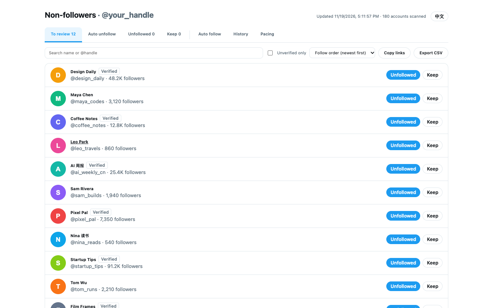
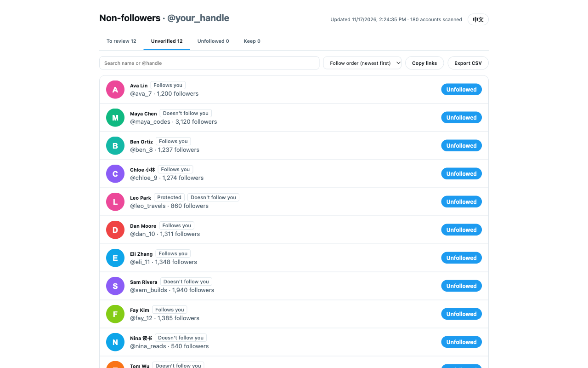
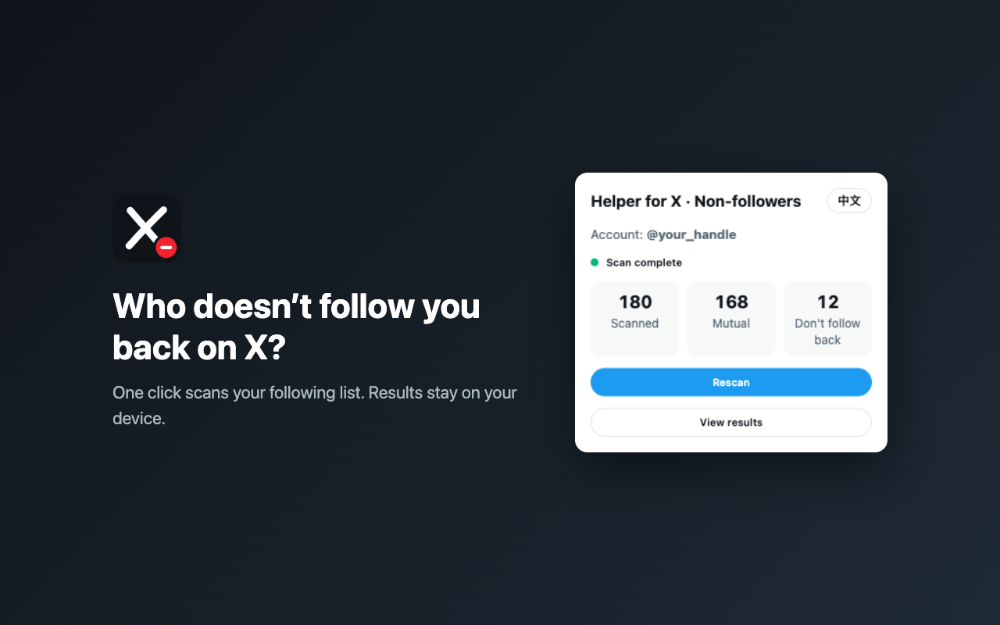
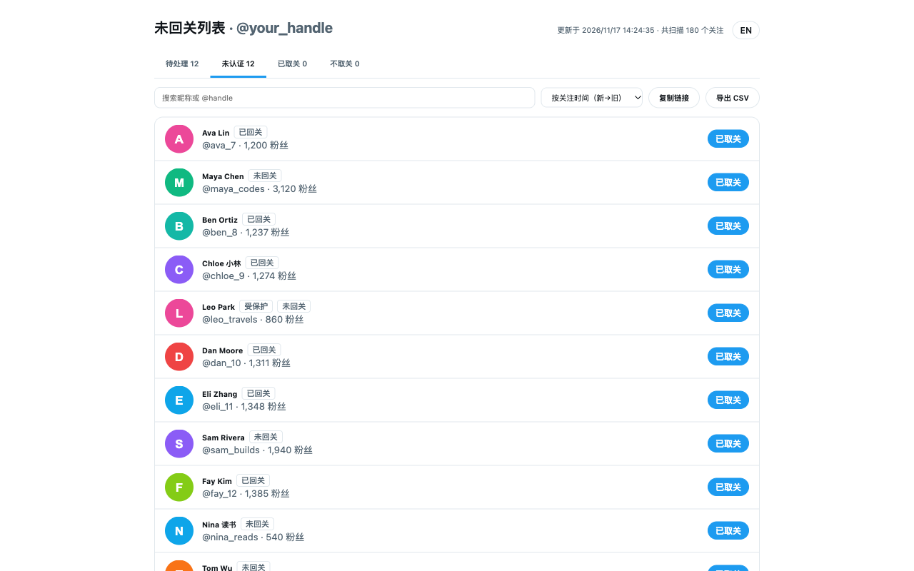

# X Helper

Chrome extension that shows which accounts you follow on X don't follow you back.

**Download:** [latest release](https://github.com/certhon/x-helper/releases/latest) · **Privacy policy:** [PRIVACY.md](PRIVACY.md) · **Author:** [@certhon520 on X](https://x.com/certhon520)

Install: unzip the release file, open `chrome://extensions`, turn on Developer mode, click **Load unpacked**, and choose the unzipped folder.

下载：[最新版本](https://github.com/certhon/x-helper/releases/latest)。安装：解压后打开 `chrome://extensions`，开启「开发者模式」，点「加载已解压的扩展程序」，选择解压后的文件夹。作者：[X 上的 @certhon520](https://x.com/certhon520)

## Screenshots

中文界面截图

Screenshots use made-up demo accounts. 截图中的账号均为虚构的演示数据。

X Helper is an independent extension and is not affiliated with X Corp.
